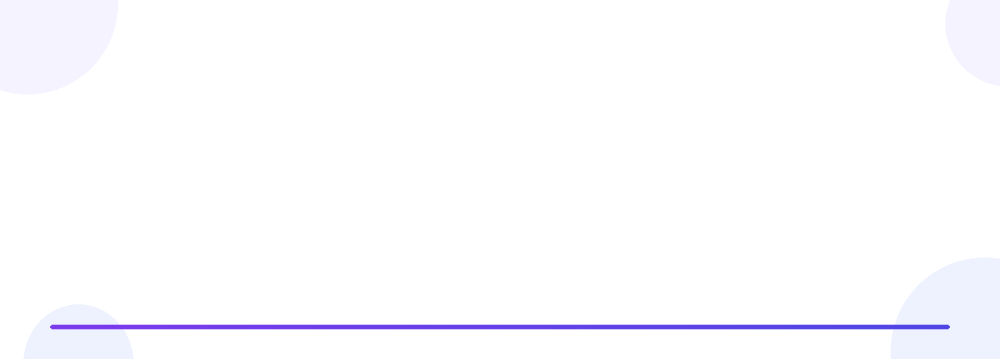
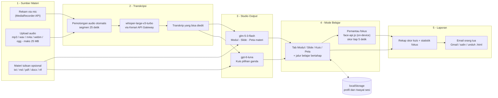
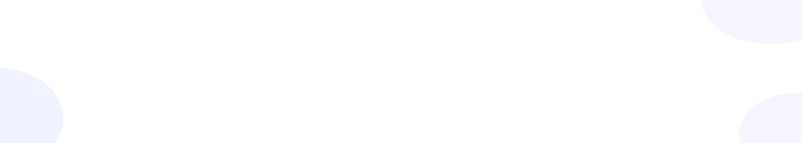

<div align="center">
  
</div>

<p align="center"></p>

<h1 align="center">LinaLearning</h1>

<p align="center"><b>Rekam pelajarannya — AI yang menyusun modul baca, slide, peta materi, dan kuis.</b><br>
Laporan belajar siap dikirim ke email orang tua. Semua berjalan di browser, tanpa instalasi.</p>

<p align="center">
  
  &nbsp;
  
  &nbsp;
  
  &nbsp;
  
  &nbsp;
  
  &nbsp;
  
</p>

---

## ✨ Highlights

> **Satu rekaman pelajaran → empat bahan belajar + pemantauan fokus + laporan orang tua.**

- 🎙️ **Rekam atau upload pelajaran** — rekam langsung lewat mic di browser, atau upload file audio/materi tulisan. PDF hasil scan pun dibaca otomatis lewat OCR.
- 📚 **Empat output AI dari satu sumber** — modul baca terstruktur, slide presentasi, peta materi, dan kuis pilihan ganda lengkap dengan pembahasan.
- 👁️ **Belajar terpantau** — kamera (opsional) + deteksi pindah tab menghitung skor fokus setiap 5 detik selama sesi belajar.
- 📧 **Orang tua tidak ketinggalan** — laporan sesi siap dikirim ke email orang tua dalam satu klik.
- ⚡ **Tanpa setup** — aplikasi web tunggal yang jalan di browser; profil dan riwayat sesi tersimpan lokal di perangkat siswa.

---

## 🧭 Tentang Proyek

| | |
|---|---|
| **Kategori** | Web — dijalankan dan diuji langsung dari browser |
| **Nama aplikasi** | LinaLearning |
| **Subtema Logicodix 2026** | *Smart & Fun Education* — AI sebagai tutor pribadi dan alat bantu visualisasi materi |
| **Masalah yang diangkat** | (1) Materi pelajaran sering sulit dicerna ulang saat belajar mandiri karena catatan tidak terstruktur. (2) Siswa butuh materi dalam beragam format — bacaan, visual, latihan soal — tapi menyusunnya manual memakan waktu berjam-jam. (3) Orang tua sulit memantau proses belajar mandiri di rumah: tidak tahu anak belajar apa, apakah fokus, dan apa hasilnya. |
| **Solusi** | LinaLearning mengubah satu sumber pelajaran (rekaman suara, file audio, atau materi tulisan) menjadi paket belajar lengkap secara otomatis dengan bantuan AI: modul baca, slide, peta materi, dan kuis. Sementara itu, monitor fokus mencatat kedisiplinan belajar dan merangkum semuanya menjadi laporan yang bisa dikirim ke email orang tua. |
| **Target pengguna** | Pelajar SMA/SMK/MA/sederajat yang belajar mandiri di rumah, serta orang tua selaku penerima laporan perkembangan belajar. |

### Alur penggunaan singkat

1. Buka aplikasi, isi **nama siswa** dan **email orang tua** (sekali saja, tersimpan di perangkat).
2. Masukkan pelajaran: **rekam mic**, **upload audio** (mp3/wav/m4a/webm/ogg, maks. 25 MB), atau **tempel/upload materi tulisan** (.txt/.md/.pdf/.docx/.rtf — PDF scan dibaca via OCR).
3. Tekan **transkrip** — suara diubah ke teks (bisa diedit kalau ada salah dengar).
4. Pilih bahan yang mau dibuat (modul/slide/peta/kuis) lalu klik **Mulai belajar** — semua bahan disusun otomatis dengan progres yang terlihat satu per satu (2–4 menit).
5. Belajar di tab **Modul**, **Slide**, **Kuis**, **Peta** — sambil mengikuti jalur belajar bertahap. Kamera bisa dinyalakan untuk mendapatkan skor fokus.
6. Klik **Selesai belajar** → lihat laporan sesi → kirim ke email orang tua.

---

## 👥 Tim

**Nama tim:** DNameless

| Peran | Nama | GitHub | Fokus pengerjaan |
|---|---|---|---|
| Ketua — arsitektur, integrasi AI/ASR, pipeline generator | Adam Rizky | [@AdamRizky1](https://github.com/AdamRizky1) | Alur aplikasi, transkripsi, modul/slide/peta/kuis, integrasi GitHub |
| Anggota — mode belajar, parsing dokumen, laporan | Sakeastern | [@sakeastern](https://github.com/sakeastern) | Monitor fokus, OCR & parser file, laporan sesi, dokumentasi |

> Tim beranggotakan 2 orang dan seluruh commit dibuat oleh akun GitHub anggota terdaftar, sesuai ketentuan *Tim dan Kolaborasi* Guidebook Logicodix 2026.

---

## 🎥 Demo & Screenshot

| Pratinjau | Tautan |
|---|---|
| 🌐 **Aplikasi live (deploy)** | [TAUTAN DEPLOY — isi sebelum submission] |
| 🎬 **Video demo (YouTube, 3–5 menit)** | [TAUTAN VIDEO DEMO — isi sebelum submission] |

<!-- Contoh pasang screenshot: taruh file di folder docs/ lalu hapus tanda komentar -->
<!--
<p align="center">
  
</p>
<p align="center">
  
</p>
<p align="center">
  
</p>
-->

**Catatan untuk juri:** aplikasi ini **tidak memakai autentikasi/akun** — profil siswa dibuat langsung di browser dan tersimpan lokal, sehingga tidak diperlukan akun demonstrasi untuk mencoba fitur utama. Direkomendasikan browser **Chrome/Edge terbaru**; mic dan kamera hanya aktif pada `http://localhost` atau HTTPS.

---

## 🚀 Fitur Utama (MVP)

MVP LinaLearning mengikuti ketentuan lomba: *fitur utama dapat dijalankan dan diuji langsung dari browser*. Alur inti yang bisa diuji juri: **isi profil → masukkan pelajaran → dapat modul, slide, peta, dan kuis → belajar dengan monitor fokus → laporan terkirim ke orang tua.**

### A. Sumber materi

| Fitur | Detail implementasi | Status |
|---|---|---|
| Rekam mic | MediaRecorder API, timer durasi, indikator merekam, deteksi mic terputus dengan pesan yang jujur | ✅ Selesai |
| Upload audio | mp3/wav/m4a/webm/ogg maks. 25 MB, pemutar pratinjau, verifikasi durasi asli file | ✅ Selesai |
| Pemotongan audio otomatis | Rekaman panjang dipotong per segmen 25 detik sesuai batas API, lalu hasilnya digabung kembali | ✅ Selesai |
| Materi tulisan opsional | Tempel teks langsung, atau file .txt/.md/.pdf/.docx/.rtf; parser .docx dan .rtf ditulis sendiri (tanpa library tambahan) | ✅ Selesai |
| OCR untuk PDF scan | Halaman PDF dirender lalu dibaca tesseract.js (Bahasa Indonesia + Inggris) di perangkat | ✅ Selesai |

### B. Studio AI

| Fitur | Detail implementasi | Status |
|---|---|---|
| Transkripsi suara ke teks | whisper-large-v3-turbo via Kenari API Gateway; hasil transkrip dapat diedit sebelum diproses | ✅ Selesai |
| Modul baca | Dokumen pelajaran terstruktur: penjelasan bertahap, contoh, ilustrasi SVG, dan kotak analogi | ✅ Selesai |
| Slide presentasi | Slide bertahap dengan navigasi tombol panah kiri/kanan | ✅ Selesai |
| Peta materi | Mind map interaktif dari pokok bahasan sampai sub-topik | ✅ Selesai |
| Kuis pilihan ganda | Soal + pembahasan, umpan balik benar/salah langsung di UI | ✅ Selesai |
| Pipeline generator | Pilih bahan yang mau dibuat (modul/slide/peta/kuis), progres tiap tahap tampil sebagai chip berjalan | ✅ Selesai |

### C. Mode belajar

| Fitur | Detail implementasi | Status |
|---|---|---|
| Tab bahan belajar | Modul, Slide, Kuis, Peta dalam satu halaman mode belajar | ✅ Selesai |
| Jalur belajar bertahap | Kurikulum step-by-step dari modul dengan penanda selesai dan progress bar | ✅ Selesai |
| Monitor fokus | Skor dihitung tiap 5 detik: fokus dihitung saat tab terbuka dan (jika kamera menyala) wajah terdeteksi via face-api.js; pindah tab, wajah hilang, atau kamera tertutup dihitung gangguan | ✅ Selesai |
| Statistik sesi | Angka fokus, jumlah pindah tab, dan jumlah wajah hilang tampil real-time | ✅ Selesai |

### D. Laporan

| Fitur | Detail implementasi | Status |
|---|---|---|
| Laporan hasil sesi | Tabel rekap: identitas sesi, durasi, skor kuis, statistik fokus | ✅ Selesai |
| Kirim ke orang tua | Tombol kirim via email/Gmail, salin laporan, dan unduh laporan sebagai .html | ✅ Selesai |
| Transkrip lengkap | Transkrip utuh bisa dibuka lagi dari halaman laporan | ✅ Selesai |
| Riwayat sesi | Daftar sesi sebelumnya tersimpan di localStorage | ✅ Selesai |

### E. Fondasi data

| Fitur | Detail implementasi | Status |
|---|---|---|
| Penyimpanan lokal | Profil siswa, riwayat sesi, dan hasil generate tersimpan di localStorage (tanpa server) | ✅ Selesai |
| Sinkronisasi cloud | Penyimpanan database cloud free-tier (hasil riset internal tim) agar data tidak hilang saat ganti perangkat | 🔜 Direncanakan |

---

## 🧠 Penggunaan AI

Sesuai ketentuan guidebook, berikut layanan/model AI yang dipakai beserta bagian produk yang memanfaatkannya:

| Bagian produk | Layanan / model | Cara kerja |
|---|---|---|
| Transkripsi audio (Langkah 3) | `whisper-large-v3-turbo` via Kenari API Gateway | Mengubah rekaman pelajaran menjadi teks yang bisa diedit |
| Modul baca, slide, peta materi | `glm-5-3-flash` via Kenari API Gateway | Model berkonteks besar untuk menyusun dokumen panjang yang terstruktur dari transkrip + materi tambahan |
| Kuis pilihan ganda | `gpt-6-luna` via Kenari API Gateway | Model cepat & konsisten untuk tugas terstruktur berulang (soal berformat JSON) |
| Baca PDF hasil scan | `tesseract.js` (on-device) | OCR halaman PDF scan, Bahasa Indonesia + Inggris — berjalan di perangkat, bukan di cloud |
| Deteksi wajah / skor fokus | `face-api.js` (on-device) | Model pre-trained lokal untuk deteksi wajah; video tidak direkam maupun dikirim |

**Etika penggunaan AI & pelindungan data:**

- AI hanya **menyusun ulang** materi yang diberikan siswa — tidak mengarang materi baru di luar sumber.
- Transkrip dapat **diedit siswa** sebelum diproses, jadi siswa tetap memegang kendali atas materi belajarnya.
- Rekaman, materi, dan hasil generate tersimpan **lokal di perangkat** (localStorage); tim tidak menjalankan server penyimpanan data siswa.
- Kamera bersifat **opsional**, hanya aktif saat siswa menyalakannya; frame video diproses di perangkat dan tidak pernah dikirim ke mana pun.
- Laporan ke orang tua **dikirim manual oleh siswa** lewat Gmail/email — tanpa pengiriman otomatis di belakang punggung.

---

## 🏗️ Arsitektur & Alur Data



**Alur data secara ringkas:**

1. **Input** — audio direkam/diunggah atau materi tulisan dimasukkan; semuanya diolah di browser.
2. **Transkripsi** — audio dikonversi ke PCM, dipotong per 25 detik, dikirim bertahap ke `whisper-large-v3-turbo`, lalu transkrip digabung dan tampil untuk diedit.
3. **Generate** — transkrip (dan/atau materi tulisan) dikirim ke model LLM melalui Kenari API Gateway; balasan diparse menjadi modul, slide, peta materi, dan kuis.
4. **Belajar** — bahan tampil di mode belajar; monitor fokus mengambil sample setiap 5 detik (tab aktif + wajah terdeteksi).
5. **Laporan** — hasil sesi dirangkum, disimpan ke localStorage, dan siap dikirim ke email orang tua.

---

## 🛠️ Teknologi

| Lapisan | Teknologi |
|---|---|
| Frontend | HTML5 + CSS3 + JavaScript vanilla (single-page, tanpa framework) |
| API AI | Kenari API Gateway (pay-as-you-go) — `whisper-large-v3-turbo`, `glm-5-3-flash`, `gpt-6-luna` |
| Library pendukung | pdf.js 3.11.174 (baca PDF), tesseract.js 5 (OCR), face-api.js 0.22.2 + weights (deteksi wajah) — dimuat via jsDelivr |
| Tipografi | Inter, Space Grotesk (Google Fonts) |
| Penyimpanan | localStorage (profil, riwayat, hasil sesi) |
| Web API browser | MediaRecorder, getUserMedia, Web Audio (decodeAudioData), DecompressionStream (parser .docx), Blob/File |
| Bahasa aplikasi | Indonesia |

---

## 🗓️ Rencana Pengembangan — Hacking Week 7–14 November 2026

Perencanaan tim sepanjang masa pengembangan (selaras dengan jadwal resmi Logicodix 2026):

| Hari | Tanggal | Kegiatan | Status |
|---|---|---|---|
| Sabtu | 7 Nov 2026 | **Mencari provider API gateway** — evaluasi layanan pay-as-you-go untuk model AI → terpilih Kenari API Gateway | ✅ Selesai |
| Minggu | 8 Nov 2026 | **Planning MVP** — menetapkan lingkup fitur inti yang dapat diuji langsung dari browser | ✅ Selesai |
| Senin | 9 Nov 2026 | **Planning fitur** — merinci setiap fitur dan pembagian tugas antar anggota | ✅ Selesai |
| Selasa | 10 Nov 2026 | **Mencari provider database free tier** untuk penyimpanan cloud (rencana sinkronisasi data) | ✅ Selesai |
| Rabu | 11 Nov 2026 | **Mengeksekusi kode** (hari ke-1) — transkripsi ASR, generator modul/slide/peta/kuis | ✅ Selesai |
| Kamis | 12 Nov 2026 | **Mengeksekusi kode** (hari ke-2) — monitor fokus, laporan sesi, integrasi antar fitur | 🔄 Hari ini |
| Jumat | 13 Nov 2026 | **Analisis kesesuaian fitur** — uji alur lengkap terhadap ketentuan lomba & rapikan integrasi | ⬜ Menyusul |
| Sabtu | 14 Nov 2026 | **Dokumentasi** final + video demo + submission (code freeze 23.59 WIB) | ⬜ Menyusul |

---

## 🔮 Roadmap Pasca-MVP

- ☁️ Sinkronisasi ke database cloud free-tier — riwayat belajar aman saat ganti perangkat.
- 👩‍🏫 Mode kelas: guru memantau banyak siswa sekaligus dari satu dashboard.
- 📄 Ekspor laporan dan modul ke PDF.
- 📈 Rekomendasi materi lanjutan berdasarkan hasil kuis antar sesi.

---

## 🧾 Konvensi Commit

Sesuai ketentuan lomba, seluruh commit dibuat berkala selama Hacking Week oleh akun GitHub anggota terdaftar, dengan pesan berawalan tipe perubahan:

```text
feat:  fitur baru          → feat: integrasi Kenari API untuk transkripsi
fix:   perbaikan bug       → fix: durasi rekaman webm yang tampil Infinity
docs:  dokumentasi         → docs: panduan instalasi di README
style: format/tampilan     → style: rapikan layout mode belajar
refactor: pembersihan kode → refactor: pisahkan parser .docx dari modul upload
chore: konfigurasi/lainnya → chore: tambahkan .env.example
```

---

## 🙏 Atribusi & Layanan Pihak Ketiga

Sesuai ketentuan guidebook, berikut seluruh sumber pihak ketiga yang dipakai:

| Aset / Layanan | Sumber | Peran dalam produk | Lisensi |
|---|---|---|---|
| Kenari API Gateway | [kenari.id](https://kenari.id) | Gateway pay-as-you-go untuk seluruh panggilan model AI (ASR + LLM) | Layanan pihak ketiga (pre-paid) |
| whisper-large-v3-turbo | diakses via Kenari | Transkripsi audio ke teks | Model pihak ketiga |
| glm-5-3-flash | diakses via Kenari | Penyusun modul, slide, peta materi | Model pihak ketiga |
| gpt-6-luna | diakses via Kenari | Penyusun kuis pilihan ganda | Model pihak ketiga |
| pdf.js 3.11.174 | [mozilla/pdf.js](https://github.com/mozilla/pdf.js) via jsDelivr | Membaca file PDF materi | Apache-2.0 |
| tesseract.js 5 | [naptha/tesseract.js](https://github.com/naptha/tesseract.js) via jsDelivr | OCR PDF hasil scan (id+en), on-device | Apache-2.0 |
| face-api.js 0.22.2 + weights | [justadudewhohacks/face-api.js](https://github.com/justadudewhohacks/face-api.js) via jsDelivr | Deteksi wajah untuk monitor fokus, on-device | MIT |
| Font Inter & Space Grotesk | [Google Fonts](https://fonts.google.com) | Tipografi antarmuka | SIL Open Font License |
| Web API browser | MediaRecorder, getUserMedia, Web Audio, DecompressionStream, localStorage | Merekam, kamera, parsing audio & .docx, penyimpanan | Standar web (W3C/WHATWG) |
| Logo, banner header animasi & footer Lina AI | Dibuat oleh tim (dirender dengan Python/Pillow) | Identitas visual & hero README | Milik tim |

**Pernyataan orisinalitas:** seluruh logika, fitur, alur kerja, dan kode aplikasi (`index.html`) dikembangkan sendiri oleh tim selama Hacking Week Logicodix 2026 — bukan repositori lama, bukan fork, dan belum pernah diikutkan kompetisi sebelumnya.

---

## 📄 Lisensi

Dirilis di bawah [Lisensi MIT](LICENSE). © 2026 Tim D'Nameless.

---

<div align="center">
  
</div>
